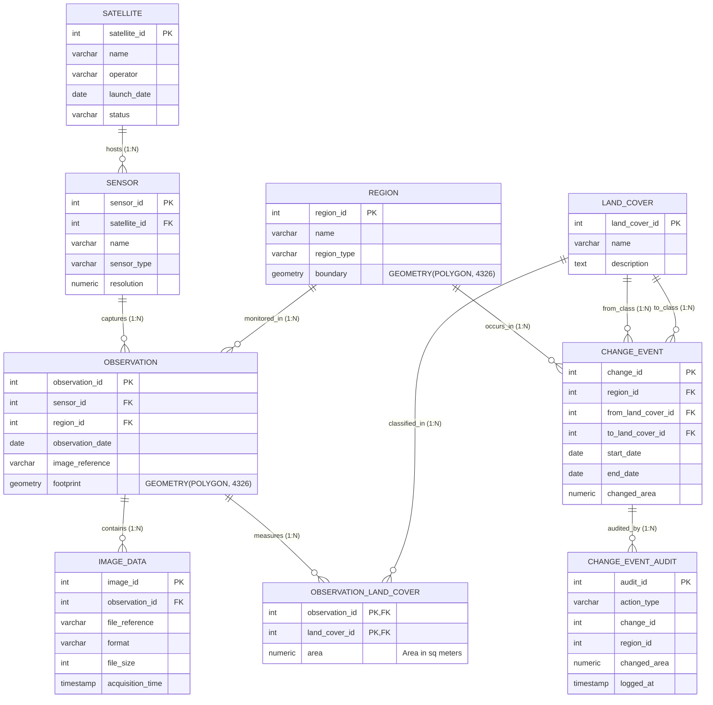
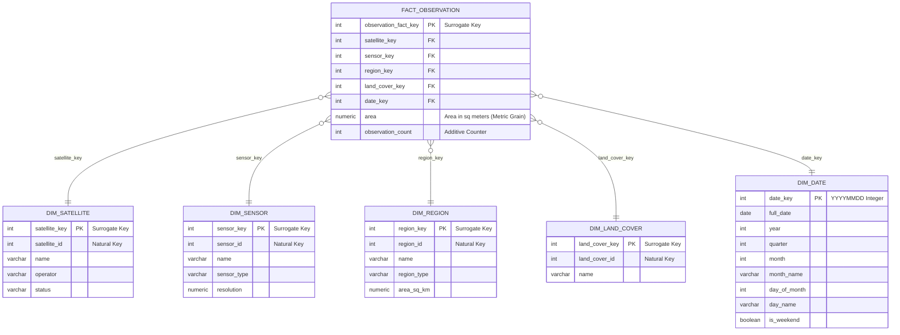

# Entity-Relationship Diagrams & Complete Data Dictionary
## Satellite Data Management & Geospatial Change Detection System
### College DBMS & Data Warehouse Laboratory Documentation

---

## 1. Entity-Relationship Diagrams (ERD)

### 1.1 Operational Schema (3NF Normalized OLTP Model)



---

### 1.2 Data Warehouse Schema (Dimensional Star Schema OLAP Model)



---

## 2. Operational Schema Data Dictionary

### Table: `operational.satellite`
| Column | Type | Constraints | Description |
| :--- | :--- | :--- | :--- |
| `satellite_id` | `INTEGER` | `PRIMARY KEY` | Unique operational identifier for satellite platform |
| `name` | `VARCHAR(100)` | `NOT NULL, UNIQUE` | Name of satellite (e.g. Sentinel-2A, Landsat-9, RISAT-1A) |
| `operator` | `VARCHAR(100)` | `NOT NULL` | Space agency or operating body (e.g. ESA, NASA, ISRO) |
| `launch_date` | `DATE` | `NOT NULL` | Orbital deployment date |
| `status` | `VARCHAR(20)` | `DEFAULT 'ACTIVE'` | Operational status (`ACTIVE`, `DECOMMISSIONED`) |

### Table: `operational.sensor`
| Column | Type | Constraints | Description |
| :--- | :--- | :--- | :--- |
| `sensor_id` | `INTEGER` | `PRIMARY KEY` | Unique operational identifier for optical or radar payload |
| `satellite_id` | `INTEGER` | `NOT NULL, FK -> satellite` | Host satellite platform foreign key |
| `name` | `VARCHAR(100)` | `NOT NULL` | Payload designation (MSI, OLI-2, C-band SAR) |
| `sensor_type` | `VARCHAR(50)` | `NOT NULL` | Classification (`Optical Multispectral`, `Synthetic Aperture Radar`) |
| `resolution` | `NUMERIC(6,2)` | `NOT NULL, CHECK > 0` | Ground spatial resolution in meters (e.g. 10m, 30m) |

### Table: `operational.region`
| Column | Type | Constraints | Description |
| :--- | :--- | :--- | :--- |
| `region_id` | `INTEGER` | `PRIMARY KEY` | Monitored region of interest unique identifier |
| `name` | `VARCHAR(100)` | `NOT NULL, UNIQUE` | Geographic zone name (e.g. Delhi NCR, Mumbai Metropolitan) |
| `region_type` | `VARCHAR(50)` | `NOT NULL` | Environmental classification (`Urban`, `Forest`, `Agriculture`, `Coastal`) |
| `boundary` | `GEOMETRY(POLYGON, 4326)` | `NOT NULL` | PostGIS 2D polygon boundary in WGS84 coordinate space |

### Table: `operational.observation`
| Column | Type | Constraints | Description |
| :--- | :--- | :--- | :--- |
| `observation_id` | `INTEGER` | `PRIMARY KEY` | Satellite acquisition pass unique identifier |
| `sensor_id` | `INTEGER` | `NOT NULL, FK -> sensor` | Sensor capturing the telemetry |
| `region_id` | `INTEGER` | `NOT NULL, FK -> region` | Target monitored territory |
| `observation_date` | `DATE` | `NOT NULL` | Acquisition calendar date |
| `image_reference` | `VARCHAR(255)` | `NOT NULL` | Telemetry swath file catalog handle |
| `footprint` | `GEOMETRY(POLYGON, 4326)` | `NOT NULL` | PostGIS 2D swath footprint polygon |

### Table: `operational.image_data`
| Column | Type | Constraints | Description |
| :--- | :--- | :--- | :--- |
| `image_id` | `INTEGER` | `PRIMARY KEY` | Imagery metadata catalog identifier |
| `observation_id` | `INTEGER` | `NOT NULL, FK -> observation` | Associated observation pass |
| `file_reference` | `VARCHAR(255)` | `NOT NULL` | Storage URL / path (e.g. GeoTIFF reference) |
| `format` | `VARCHAR(20)` | `DEFAULT 'GeoTIFF'` | Format identifier (`GeoTIFF`, `Cloud-Optimized GeoTIFF`) |
| `file_size` | `INTEGER` | `CHECK > 0` | Image file size in bytes |
| `acquisition_time` | `TIMESTAMP` | `NOT NULL` | Exact UTC satellite acquisition timestamp |

### Table: `operational.land_cover`
| Column | Type | Constraints | Description |
| :--- | :--- | :--- | :--- |
| `land_cover_id` | `INTEGER` | `PRIMARY KEY` | Land classification code |
| `name` | `VARCHAR(50)` | `NOT NULL, UNIQUE` | Class designation (`Urban`, `Forest`, `Agriculture`, `Water`, `Barren`) |
| `description` | `TEXT` | `NULLABLE` | Detailed IPCC/CORINE land cover taxonomy notes |

### Table: `operational.observation_land_cover`
| Column | Type | Constraints | Description |
| :--- | :--- | :--- | :--- |
| `observation_id` | `INTEGER` | `PK, FK -> observation` | Composite primary key component |
| `land_cover_id` | `INTEGER` | `PK, FK -> land_cover` | Composite primary key component |
| `area` | `NUMERIC(14,2)` | `NOT NULL, CHECK >= 0` | Measured area for this category in square meters |

### Table: `operational.change_event`
| Column | Type | Constraints | Description |
| :--- | :--- | :--- | :--- |
| `change_id` | `INTEGER` | `PRIMARY KEY` | Transition event unique identifier |
| `region_id` | `INTEGER` | `NOT NULL, FK -> region` | Region where transition occurred |
| `from_land_cover_id` | `INTEGER` | `NOT NULL, FK -> land_cover` | Initial land cover class |
| `to_land_cover_id` | `INTEGER` | `NOT NULL, FK -> land_cover` | Post-transition land cover class |
| `start_date` | `DATE` | `NOT NULL` | Baseline observation date |
| `end_date` | `DATE` | `NOT NULL, CHECK end > start` | Terminal evaluation date |
| `changed_area` | `NUMERIC(14,2)` | `NOT NULL, CHECK > 0` | Transitioned area in square meters |

### Table: `operational.change_event_audit`
| Column | Type | Constraints | Description |
| :--- | :--- | :--- | :--- |
| `audit_id` | `SERIAL` | `PRIMARY KEY` | Auto-incrementing audit log entry ID |
| `action_type` | `VARCHAR(10)` | `NOT NULL` | Trigger event (`INSERT`, `UPDATE`) |
| `change_id` | `INTEGER` | `NOT NULL` | Reference to modified change event |
| `region_id` | `INTEGER` | `NOT NULL` | Region identifier |
| `changed_area` | `NUMERIC(14,2)` | `NOT NULL` | Shifted area recorded during operation |
| `logged_at` | `TIMESTAMP` | `DEFAULT CURRENT_TIMESTAMP` | Database engine transaction timestamp |

---

## 3. Data Warehouse Schema Data Dictionary

### Dimension: `warehouse.dim_date`
| Column | Type | Constraints | Description |
| :--- | :--- | :--- | :--- |
| `date_key` | `INTEGER` | `PRIMARY KEY` | Pre-calculated numerical surrogate key `YYYYMMDD` |
| `full_date` | `DATE` | `NOT NULL, UNIQUE` | Standard Gregorian calendar date (2021-01-01 to 2025-12-31) |
| `year` | `SMALLINT` | `NOT NULL` | Calendar Year (2021-2025) |
| `quarter` | `SMALLINT` | `NOT NULL, CHECK 1-4` | Calendar Quarter (1 to 4) |
| `month` | `SMALLINT` | `NOT NULL, CHECK 1-12`| Calendar Month (1 to 12) |
| `month_name` | `VARCHAR(10)` | `NOT NULL` | Full Month Name (January, February, etc.) |
| `day_of_month` | `SMALLINT` | `NOT NULL, CHECK 1-31`| Day within month |
| `day_name` | `VARCHAR(10)` | `NOT NULL` | Day of week (Monday, Tuesday, etc.) |
| `is_weekend` | `BOOLEAN` | `NOT NULL` | Weekend indicator flag |

### Dimension: `warehouse.dim_satellite`
| Column | Type | Constraints | Description |
| :--- | :--- | :--- | :--- |
| `satellite_key` | `INT IDENTITY` | `PRIMARY KEY` | Analytical surrogate key |
| `satellite_id` | `INTEGER` | `NOT NULL` | Operational source system natural key |
| `name` | `VARCHAR(100)` | `NOT NULL` | Platform name |
| `operator` | `VARCHAR(100)` | `NOT NULL` | Agency / operator |
| `status` | `VARCHAR(20)` | `NOT NULL` | Operational state |

### Dimension: `warehouse.dim_sensor`
| Column | Type | Constraints | Description |
| :--- | :--- | :--- | :--- |
| `sensor_key` | `INT IDENTITY` | `PRIMARY KEY` | Analytical surrogate key |
| `sensor_id` | `INTEGER` | `NOT NULL` | Operational source system natural key |
| `name` | `VARCHAR(100)` | `NOT NULL` | Sensor payload name |
| `sensor_type` | `VARCHAR(50)` | `NOT NULL` | Sensor technology (Optical / Radar) |
| `resolution` | `NUMERIC(6,2)` | `NOT NULL` | Spatial resolution in meters |

### Dimension: `warehouse.dim_region`
| Column | Type | Constraints | Description |
| :--- | :--- | :--- | :--- |
| `region_key` | `INT IDENTITY` | `PRIMARY KEY` | Analytical surrogate key |
| `region_id` | `INTEGER` | `NOT NULL` | Operational source system natural key |
| `name` | `VARCHAR(100)` | `NOT NULL` | Territory name |
| `region_type` | `VARCHAR(50)` | `NOT NULL` | Environmental category |
| `area_sq_km` | `NUMERIC(10,2)` | `NOT NULL` | Pre-calculated geodetic boundary surface area |

### Dimension: `warehouse.dim_land_cover`
| Column | Type | Constraints | Description |
| :--- | :--- | :--- | :--- |
| `land_cover_key` | `INT IDENTITY` | `PRIMARY KEY` | Analytical surrogate key |
| `land_cover_id` | `INTEGER` | `NOT NULL` | Operational source system natural key |
| `name` | `VARCHAR(50)` | `NOT NULL` | Category name (`Urban`, `Forest`, `Agriculture`, `Water`, `Barren`) |

### Fact Table: `warehouse.fact_observation`
| Column | Type | Constraints | Description |
| :--- | :--- | :--- | :--- |
| `observation_fact_key` | `BIGINT IDENTITY` | `PRIMARY KEY` | Central fact table surrogate key |
| `satellite_key` | `INTEGER` | `NOT NULL, FK -> dim_satellite` | Foreign key to satellite dimension |
| `sensor_key` | `INTEGER` | `NOT NULL, FK -> dim_sensor` | Foreign key to sensor dimension |
| `region_key` | `INTEGER` | `NOT NULL, FK -> dim_region` | Foreign key to region dimension |
| `land_cover_key` | `INTEGER` | `NOT NULL, FK -> dim_land_cover` | Foreign key to land cover dimension |
| `date_key` | `INTEGER` | `NOT NULL, FK -> dim_date` | Foreign key to calendar date dimension |
| `area` | `NUMERIC(14,2)` | `NOT NULL, CHECK >= 0` | Measured area metric in square meters |
| `observation_count` | `INTEGER` | `DEFAULT 1, CHECK > 0` | Additive unit counter for aggregation |

**Strict Fact Grain Enforcement**:
```sql
CONSTRAINT uq_fact_grain UNIQUE (region_key, date_key, sensor_key, land_cover_key)
```

---

## 4. Indexing & Optimization Registry

| Index Name | Table | Method | Indexed Columns | Justification |
| :--- | :--- | :--- | :--- | :--- |
| `idx_region_boundary_gist` | `operational.region` | **GiST (R-Tree)** | `(boundary)` | Accelerates spatial containment and intersection queries |
| `idx_observation_footprint_gist` | `operational.observation` | **GiST (R-Tree)** | `(footprint)` | Sub-millisecond filtering of satellite swath footprints |
| `idx_fact_region_date` | `warehouse.fact_observation` | **B-Tree** | `(region_key, date_key)` | Accelerates temporal regional slicing and time-series joins |
| `idx_fact_land_cover` | `warehouse.fact_observation` | **B-Tree** | `(land_cover_key)` | Accelerates category-specific window partitions (e.g. Forest loss) |
| `idx_mvw_region_quarter_lc` | `mvw_regional_quarterly_landcover` | **B-Tree (Unique)** | `(region_key, year, quarter, land_cover_key)` | Supports concurrent refreshes and instant dashboard lookups |
