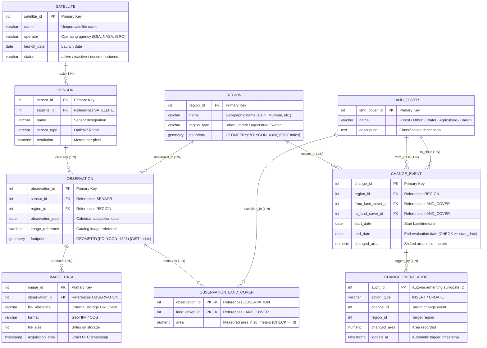
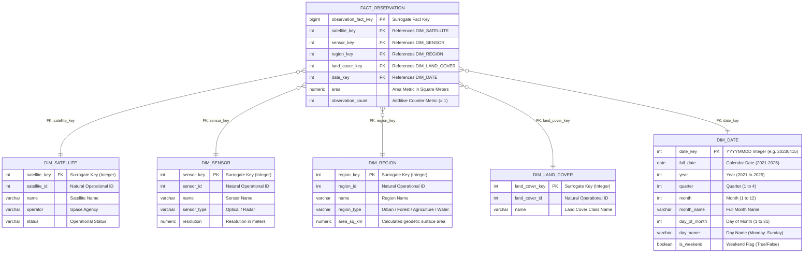

# Entity-Relationship (ER) & Relational Schema Diagrams
## Satellite Data Management and Geospatial Change Detection System
### Selected Track: Track C — Data Warehouse and Analytics
**Institution:** JK Lakshmipat University (JKLU)  
**Course:** Modern Data Management, Database Systems and Advanced Database Applications  
**Team Members:** Rishi Jangid, Daksh Vashistha, Harshit Nagar, Aarav Jain, Vaibhav Jain  

---

## Table of Contents
1. [Overview of the Two Database Models](#1-overview-of-the-two-database-models)
2. [Operational Schema (OLTP) — 3NF Entity-Relationship Diagram](#2-operational-schema-oltp--3nf-entity-relationship-diagram)
3. [Operational Schema Relational Notation (Logical Schema)](#3-operational-schema-relational-notation-logical-schema)
4. [Data Warehouse Schema (OLAP) — Star Schema Diagram](#4-data-warehouse-schema-olap--star-schema-diagram)
5. [Data Warehouse Relational Notation](#5-data-warehouse-relational-notation)
6. [Relationship & Cardinality Reference Table](#6-relationship--cardinality-reference-table)

---

## 1. Overview of the Two Database Models

As specified in our project proposal (Track C), the system implements a **two-tier hybrid architecture**:
1. **Operational Database (`operational` schema)**: A normalized relational database in **Third Normal Form (3NF)** with PostGIS spatial extensions. Designed for transactional integrity, fast data ingestion, and zero update/deletion anomalies.
2. **Data Warehouse (`warehouse` schema)**: A dimensional **Star Schema** optimized for Online Analytical Processing (OLAP), historical time-series queries, multi-level aggregations (`ROLLUP`/`CUBE`), and window functions.

---

## 2. Operational Schema (OLTP) — 3NF Entity-Relationship Diagram

### 2.1 Mermaid ER Visual Diagram
*(Renders automatically in GitHub, VS Code, and Markdown viewers)*



---

### 2.2 Text / Block Architecture Diagram

```
+-------------------+             +-------------------+
|     SATELLITE     | 1         N |      SENSOR       |
|-------------------|-------------|-------------------|
| PK satellite_id   |<------------| PK sensor_id      |
|    name           |             | FK satellite_id   |
|    operator       |             |    name           |
|    launch_date    |             |    sensor_type    |
|    status         |             |    resolution     |
+-------------------+             +-------------------+
                                            | 1
                                            |
                                            | N
+-------------------+             +-------------------+             +-------------------+
|      REGION       | 1         N |    OBSERVATION    | 1         N |    IMAGE_DATA     |
|-------------------|-------------|-------------------|-------------|-------------------|
| PK region_id      |<------------| PK observation_id |<------------| PK image_id       |
|    name           |             | FK sensor_id      |             | FK observation_id |
|    region_type    |             | FK region_id      |             |    file_reference |
|    boundary (geom)|             |    date           |             |    format         |
+-------------------+             |    image_ref      |             |    file_size      |
      | 1                         |    footprint(geom)|             |    acq_time       |
      |                           +-------------------+             +-------------------+
      |                                     | 1
      | N                                   | N
+-------------------+             +--------------------------+
|   CHANGE_EVENT    |             |  OBSERVATION_LAND_COVER  |
|-------------------|             |--------------------------|
| PK change_id      |             | PK,FK observation_id     |
| FK region_id      |             | PK,FK land_cover_id      |
| FK from_cover_id  |----+        |       area               |
| FK to_cover_id    |--+ |        +--------------------------+
|    start_date     |  | |                     | N
|    end_date       |  | |                     | 1
|    changed_area   |  | |        +--------------------------+
+-------------------+  | |        |        LAND_COVER        |
      | 1              | |        |--------------------------|
      | (Trigger)      | +------->| PK land_cover_id         |
      v N              +--------->|    name                  |
+--------------------+            |    description           |
| CHANGE_EVENT_AUDIT |            +--------------------------+
|--------------------|
| PK audit_id        |
|    action_type     |
|    change_id       |
|    region_id       |
|    changed_area    |
|    logged_at       |
+--------------------+
```

---

## 3. Operational Schema Relational Notation (Logical Schema)

*Primary Keys are denoted in **bold** and `[PK]`. Foreign Keys are denoted in `[FK]`.*

1. **`satellite`** (
   **`satellite_id`** `[PK]`, 
   `name`, 
   `operator`, 
   `launch_date`, 
   `status`
   )

2. **`sensor`** (
   **`sensor_id`** `[PK]`, 
   `satellite_id` `[FK -> satellite.satellite_id]`, 
   `name`, 
   `sensor_type`, 
   `resolution`
   )

3. **`region`** (
   **`region_id`** `[PK]`, 
   `name`, 
   `region_type`, 
   `boundary` *(PostGIS GEOMETRY(POLYGON, 4326))*
   )

4. **`observation`** (
   **`observation_id`** `[PK]`, 
   `sensor_id` `[FK -> sensor.sensor_id]`, 
   `region_id` `[FK -> region.region_id]`, 
   `observation_date`, 
   `image_reference`, 
   `footprint` *(PostGIS GEOMETRY(POLYGON, 4326))*
   )

5. **`image_data`** (
   **`image_id`** `[PK]`, 
   `observation_id` `[FK -> observation.observation_id]`, 
   `file_reference`, 
   `format`, 
   `file_size`, 
   `acquisition_time`
   )

6. **`land_cover`** (
   **`land_cover_id`** `[PK]`, 
   `name`, 
   `description`
   )

7. **`observation_land_cover`** (
   **`observation_id`** `[PK, FK -> observation.observation_id]`, 
   **`land_cover_id`** `[PK, FK -> land_cover.land_cover_id]`, 
   `area`
   )

8. **`change_event`** (
   **`change_id`** `[PK]`, 
   `region_id` `[FK -> region.region_id]`, 
   `from_land_cover_id` `[FK -> land_cover.land_cover_id]`, 
   `to_land_cover_id` `[FK -> land_cover.land_cover_id]`, 
   `start_date`, 
   `end_date`, 
   `changed_area`
   )

9. **`change_event_audit`** (
   **`audit_id`** `[PK]`, 
   `action_type`, 
   `change_id`, 
   `region_id`, 
   `changed_area`, 
   `logged_at`
   )

---

## 4. Data Warehouse Schema (OLAP) — Star Schema Diagram

In the dimensional model, the **Fact Table** sits at the center, surrounded by **Dimension Tables** radiating outwards like a star.

### 4.1 Mermaid Star Schema Visual Diagram



---

### 4.2 Text / Block Star Schema Layout

```
                  +---------------------------+
                  |       DIM_SATELLITE       |
                  |---------------------------|
                  | PK satellite_key          |
                  |    satellite_id           |
                  |    name, operator, status |
                  +---------------------------+
                                |
                                | 1
                                |
+-----------------------+       | N     +-------------------------+
|      DIM_SENSOR       |       |       |       DIM_REGION        |
|-----------------------|       |       |-------------------------|
| PK sensor_key         | 1     |     1 | PK region_key           |
|    sensor_id          |-------+-------|    region_id            |
|    name, type, res    |       |       |    name, type, area_km2 |
+-----------------------+       |       +-------------------------+
                                |
                                v
               +---------------------------------+
               |        FACT_OBSERVATION         |
               |---------------------------------|
               | PK  observation_fact_key        |
               | FK  satellite_key               |
               | FK  sensor_key                  |
               | FK  region_key                  |
               | FK  land_cover_key              |
               | FK  date_key                    |
               | ------------------------------- |
               | M   area (numeric, sq meters)   |
               | M   observation_count (int = 1) |
               +---------------------------------+
                                ^
                                |
            +-------------------+-------------------+
            |                                       |
            | N                                     | N
            | 1                                     | 1
+---------------------------+       +-------------------------------+
|      DIM_LAND_COVER       |       |           DIM_DATE            |
|---------------------------|       |-------------------------------|
| PK land_cover_key         |       | PK date_key (YYYYMMDD)        |
|    land_cover_id          |       |    full_date, year, quarter   |
|    name                   |       |    month, month_name, day     |
+---------------------------+       |    day_name, is_weekend       |
                                    +-------------------------------+
```

---

## 5. Data Warehouse Relational Notation

1. **`dim_satellite`** (
   **`satellite_key`** `[PK]`, 
   `satellite_id`, 
   `name`, 
   `operator`, 
   `status`
   )

2. **`dim_sensor`** (
   **`sensor_key`** `[PK]`, 
   `sensor_id`, 
   `name`, 
   `sensor_type`, 
   `resolution`
   )

3. **`dim_region`** (
   **`region_key`** `[PK]`, 
   `region_id`, 
   `name`, 
   `region_type`, 
   `area_sq_km`
   )

4. **`dim_land_cover`** (
   **`land_cover_key`** `[PK]`, 
   `land_cover_id`, 
   `name`
   )

5. **`dim_date`** (
   **`date_key`** `[PK: YYYYMMDD]`, 
   `full_date`, 
   `year`, 
   `quarter`, 
   `month`, 
   `month_name`, 
   `day_of_month`, 
   `day_name`, 
   `is_weekend`
   )

6. **`fact_observation`** (
   **`observation_fact_key`** `[PK]`, 
   `satellite_key` `[FK -> dim_satellite.satellite_key]`, 
   `sensor_key` `[FK -> dim_sensor.sensor_key]`, 
   `region_key` `[FK -> dim_region.region_key]`, 
   `land_cover_key` `[FK -> dim_land_cover.land_cover_key]`, 
   `date_key` `[FK -> dim_date.date_key]`, 
   `area` *(Additive Measure)*, 
   `observation_count` *(Additive Counter)*
   )  
   *Enforced Fact Grain Constraint:*  
   `UNIQUE (region_key, date_key, sensor_key, land_cover_key)`

---

## 6. Relationship & Cardinality Reference Table

| Parent Entity | Child Entity | Relationship | Cardinality | Business Meaning |
| :--- | :--- | :--- | :--- | :--- |
| **`satellite`** | **`sensor`** | Hosts | $1 : N$ | One satellite hosts one or more sensor instruments. Each sensor belongs to exactly one satellite platform. |
| **`sensor`** | **`observation`** | Captures | $1 : N$ | A sensor performs multiple observation passes over time. Each observation pass is captured by one sensor. |
| **`region`** | **`observation`** | Targets | $1 : N$ | A region is monitored across multiple observation passes over time. |
| **`observation`** | **`image_data`** | Generates | $1 : N$ | An observation pass produces image files (or multi-band GeoTIFFs) stored externally. |
| **`observation`** | **`observation_land_cover`** | Decomposes | $1 : N$ | An observation pass contains area measurements for multiple land cover categories. |
| **`land_cover`** | **`observation_land_cover`** | Classifies | $1 : N$ | A land cover class (e.g. Forest) is measured across many observation passes. |
| **`region`** | **`change_event`** | Experiences | $1 : N$ | A monitored region experiences multiple detected land cover transition events across years. |
| **`land_cover`** | **`change_event`** | Transitions | $1 : N$ | Used twice (for `from_land_cover_id` and `to_land_cover_id`) to track land transitions. |
| **`change_event`** | **`change_event_audit`** | Logs | $1 : N$ | Every INSERT or UPDATE on a change event is automatically recorded in the audit trail by a trigger. |
| **`dim_*` (all)** | **`fact_observation`** | Dimensions | $1 : N$ | Each dimension row contextualizes many measurements in the central fact table. |
