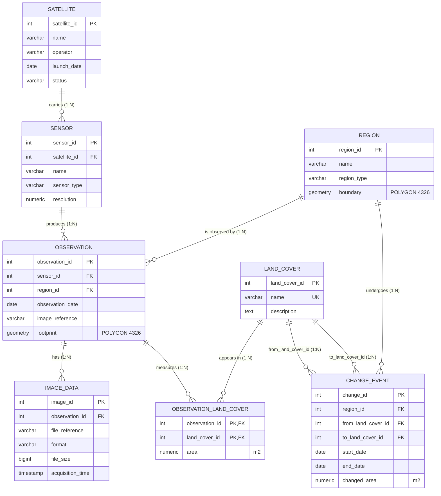
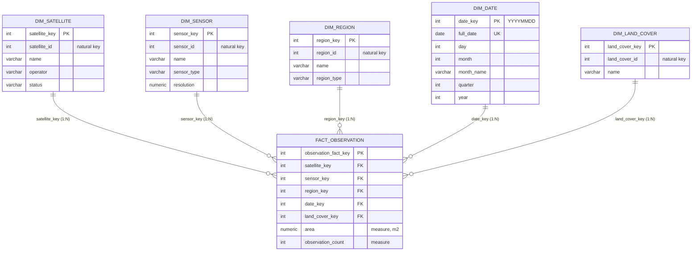

# Entity-Relationship (ER) & Relational Schema Diagrams
## Satellite Data Management and Geospatial Change Detection System
**Track C — Data Warehouse and Analytics**

---

## 1. Overview of the Dual-Schema Architecture

The system features two complementary database schemas:
1. **Operational Schema (`operational`)**: Modeled in **Third Normal Form (3NF)** with PostGIS spatial types for transactional reliability and spatial topology.
2. **Data Warehouse Schema (`warehouse`)**: Modeled as a **Star Schema** with surrogate keys and an explicit grain for Online Analytical Processing (OLAP).

---

## 2. Operational Schema (3NF) — Entity-Relationship Diagram

### 2.1 Mermaid Diagram

### 2.2 Visual Architecture Diagram Render
An SVG and high-resolution render of the relational schema is available in the repository:
- **Vector Graphic:** [er_diagram.svg](file:///d:/dbms%20project/satelite-change-detection/docs/er_diagram.svg)
- **High-Res Graphic:** [er_diagram.jpg](file:///d:/dbms%20project/satelite-change-detection/docs/er_diagram.jpg)
- **Interactive Browser Viewer:** [view_er_diagram.html](file:///d:/dbms%20project/satelite-change-detection/docs/view_er_diagram.html)

---

## 3. Data Warehouse Schema — Star Schema Diagram

### 3.1 Mermaid Star Schema

---

## 4. Relationship & Cardinality Reference Table

| Parent Entity | Child Entity | Relationship Type | Foreign Key Attribute | Enforcement Mechanism |
| :--- | :--- | :--- | :--- | :--- |
| `SATELLITE` | `SENSOR` | 1 to Many (1:N) | `sensor.satellite_id` | `NOT NULL REFERENCES satellite(satellite_id)` |
| `SENSOR` | `OBSERVATION` | 1 to Many (1:N) | `observation.sensor_id` | `NOT NULL REFERENCES sensor(sensor_id)` |
| `REGION` | `OBSERVATION` | 1 to Many (1:N) | `observation.region_id` | `NOT NULL REFERENCES region(region_id)` |
| `OBSERVATION` | `IMAGE_DATA` | 1 to Many (1:N) | `image_data.observation_id` | `NOT NULL REFERENCES observation(observation_id)` |
| `OBSERVATION` | `OBS_LAND_COVER`| 1 to Many (1:N) | `obs_land_cover.observation_id` | Composite PK + FK |
| `LAND_COVER` | `OBS_LAND_COVER`| 1 to Many (1:N) | `obs_land_cover.land_cover_id` | Composite PK + FK |
| `REGION` | `CHANGE_EVENT` | 1 to Many (1:N) | `change_event.region_id` | `NOT NULL REFERENCES region(region_id)` |
| `LAND_COVER` | `CHANGE_EVENT` | 1 to Many (1:N) | `change_event.from_land_cover_id` | `NOT NULL REFERENCES land_cover(land_cover_id)` |
| `LAND_COVER` | `CHANGE_EVENT` | 1 to Many (1:N) | `change_event.to_land_cover_id` | `NOT NULL REFERENCES land_cover(land_cover_id)` |
